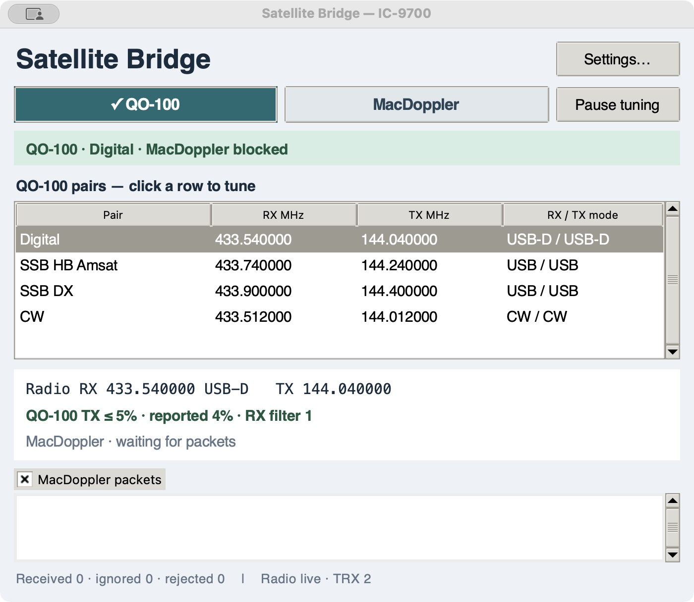
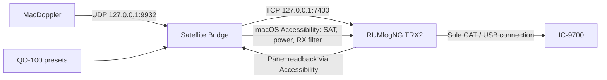

# Satellite Bridge for the IC-9700

**MacDoppler UDP → Satellite Bridge → RUMlogNG TRX2 → IC-9700**

A small macOS app for keeping QO-100 operation and MacDoppler-controlled LEO operation on the same IC-9700, while **RUMlogNG remains the sole CAT controller connected to the radio**.

**Initial public preview: 1.0.4 · Intel macOS · MIT license**

[Download the app](https://github.com/matpet/satellite-bridge/releases/tag/v1.0.4) · [User guide](docs/USER-GUIDE.md) · [Why this app exists](docs/WHY.md) · [PDF guide](output/pdf/Satellite-Bridge-Guide-1.0.4.pdf) · [Planned features](docs/ROADMAP.md)



*Actual app window on the original station. The packet feed is visible; no MacDoppler packets were arriving when this screenshot was taken.*

## Why I wanted this app

My IC-9700 is configured as **TRX2 in RUMlogNG**. I wanted to keep that arrangement, rather than make MacDoppler or another application take over the radio's CAT/USB connection.

QO-100 is my regular operating environment. I use several RX/TX frequency pairs for digital operation, SSB and CW. Meanwhile, MacDoppler can track LEO satellites in the background. I wanted one deliberate click to let MacDoppler control both frequencies, and another to return to a QO-100 pair without its continuing UDP broadcasts disturbing that operation.

The QO-100 transmit output feeds a converter, so this mode also needs a **maximum RF power setting of 5%**. See the [design rationale](docs/WHY.md).

## How the connection works



The bridge does not open a serial port. MacDoppler uses its UDP Broadcast radio driver, not a second direct CAT connection.

## What 1.0.4 does

| Source | Tuning behavior |
| --- | --- |
| **QO-100** | One batch of RX/TX frequency and mode commands per explicit pair selection. MacDoppler packets remain visible but are blocked. Manual radio tuning is left alone. |
| **MacDoppler** | Forward ongoing Doppler updates only while this source is selected. Downlink controls RX; uplink controls TX independently. Unchanged fields are not resent. |
| **Pause tuning** | Stop frequency/mode output while continuing packet display and feedback. The QO-100 power guard continues when QO-100 is selected. |

- New launches select the saved pair named **Digital**, with MacDoppler blocked.
- The QO-100 power ceiling is set and checked before tuning, checked afterward, and monitored. This radio commonly reports 4% after a 5% request.
- QO-100 RX filter rules: **CW/CW-R → filter 2; USB/USB-D → filter 1**. The TX filter is not changed.
- Edit saved pairs in Settings; click one row in Operations to tune it.
- Display both VFO frequency readbacks and actual incoming MacDoppler packets.
- Confirm QO-100 feedback after selection without automatically retrying a frequency setter. A mismatch remains visible and manual tuning stays available.
- Recover from temporary power-read failures without replaying an already-sent tuning batch.
- Source/mode changes wait for operator PTT release. The bridge never commands PTT on or off.

## Setup

1. Download and extract the Intel app ZIP from [Releases](https://github.com/matpet/satellite-bridge/releases).
2. Copy `Satellite Bridge.app` to an Applications folder. The app includes Python and Tk; Terminal is not needed to run it.
3. For a different station, first launch with RUMlogNG closed and edit the example IF/dial pairs in Settings. Keep exactly one pair named **Digital**. Every later launch applies Digital automatically when access and power verification are ready.
4. Configure the IC-9700 as **TRX2 in RUMlogNG**, using RUMlogNG's IC-9700 control panel and its TRX2 DXLab Commander server on **TCP 7400**.
5. In MacDoppler, select **UDP Broadcast**, destination **127.0.0.1**, port **9932**, and enable Radio output.
6. Enable Satellite Bridge in **System Settings → Privacy & Security → Accessibility**.

See the [full setup and operating guide](docs/USER-GUIDE.md). The release is locally ad-hoc signed, **not Developer ID signed or notarized**; macOS may block a downloaded copy. [Apple explains the available controls](https://support.apple.com/en-us/102445). Do not disable system-wide security protections to install it.

## Current limitations

- **1.0.4 automatically enables RUMlogNG's Toggle control during feedback reads. Turning it off in the panel is not preserved.** Respecting the operator's setting is planned, but that fix is **not** in this release.
- Readback comes from RUMlogNG's panel, not an independent radio connection. A requested value can appear before a later CAT poll reports the previous value. Verification does not retry the tuning command.
- Missing TX modes are omitted; missing frequencies say waiting and old feedback is labelled stale.
- CTCSS fields in MacDoppler reports are not forwarded.
- Terrestrial/repeater/simplex profiles and **80% default power in MacDoppler or terrestrial mode are planned, not implemented**. Switching to MacDoppler currently does not raise power.
- The 5% guard is a software setting and monitor, not a hardware RF limiter.
- Tested on one Intel Mac with macOS 15.7.3, RUMlogNG 6.5.1 and MacDoppler 2.48. No native Apple Silicon build is provided.

## Development and validation

The app uses Python's standard library, Tk, and native macOS Accessibility calls. Building the bundled app requires Python 3.12+ with Tk 9 and PyInstaller 6.22.3.

```sh
python3 -m unittest test_bridge test_app_packaging test_native_control -v
python3 -m pip install -r requirements-build.txt
python3 build_macos_app.py
```

The **50 local tests** use simulated endpoints; they do not tune the IC-9700. Live tests on the original station separately confirmed independent RX/TX changes. See [development](docs/DEVELOPMENT.md) and [validation](docs/VALIDATION.md) for the evidence and its limits.

Settings and logs live in `~/Library/Application Support/Satellite Bridge/`, outside the app bundle. Public source and release assets exclude local radio logs, packet captures, account details and machine-specific test artifacts.

## License

Original bridge code and documentation: [MIT](LICENSE), copyright 2026 Matthias Peter. Bundled runtime components retain their own licenses; see [third-party notices](THIRD-PARTY-NOTICES.md). RUMlogNG, MacDoppler and Icom software are not included.
