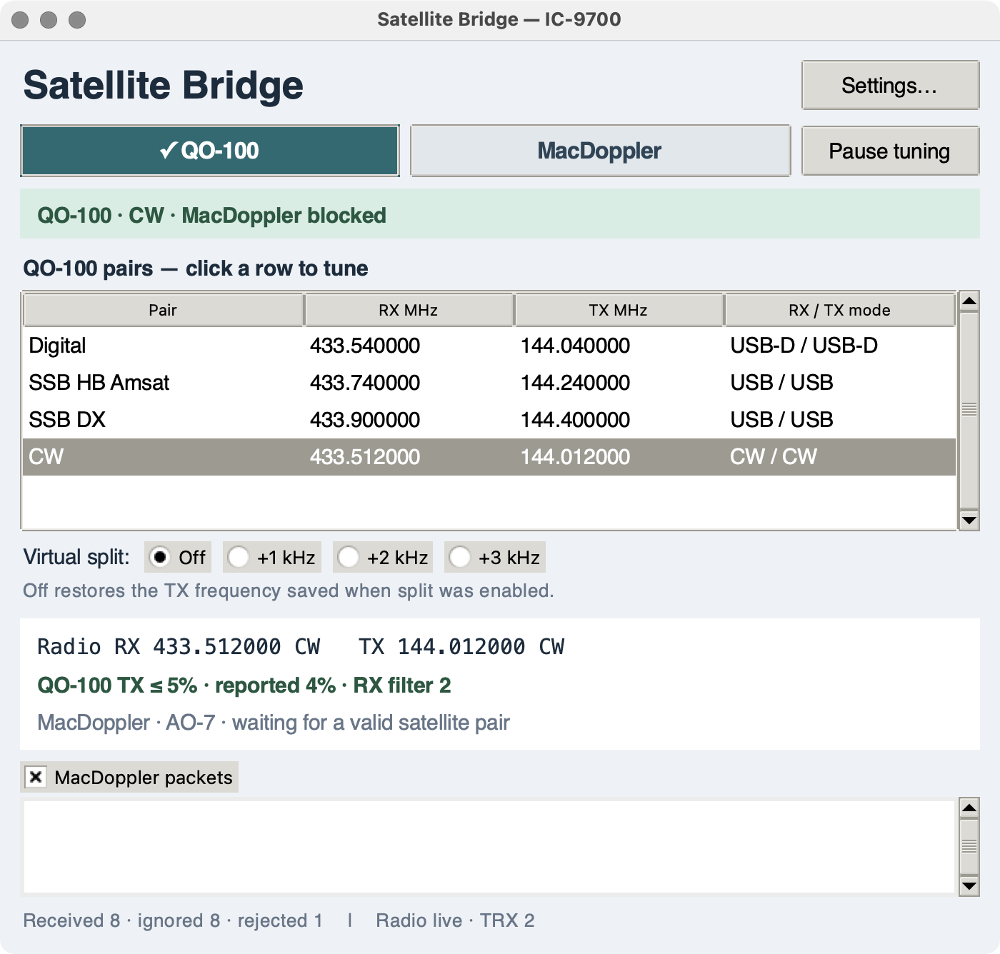

# User guide - version 1.0.6

## 1. Requirements and connections

This release supplies an Intel macOS app. The 1.0.6 SAT-preserving preset switching was tested on macOS 15.7.3 with RUMlogNG 6.6.1 and an IC-9700 attached by USB. Earlier UDP tests used RUMlogNG 6.5.1 and MacDoppler 2.48. Compatibility with other versions and Apple Silicon has not been established.

| Connection | Setting | Purpose |
| --- | --- | --- |
| MacDoppler → bridge | UDP `127.0.0.1:9932` | Incoming radio reports |
| Bridge → RUMlogNG TRX2 | TCP `127.0.0.1:7400` | Frequency, mode and PTT-status queries |
| Bridge ↔ RUMlogNG panel | macOS Accessibility | VFOs, tone controls, receiver profile, power, filters and feedback |
| RUMlogNG → IC-9700 | Existing CAT/USB connection | Sole radio connection |

The bridge does not connect to the IC-9700 serial device. Do not configure a second direct MacDoppler CAT connection to the same radio. Existing services for other applications do not need their ports changed.

RUMlogNG's [IC-9700 documentation](https://dl2rum.de/RUMlogNG/docs/en/pages/CAT-IC9700.html) recommends 115200 baud for USB. The original station was tested at 19200. A baud change must be coordinated at both ends; the bridge does not change either setting.

## 2. Install and prepare your station

1. Download the Intel ZIP from the GitHub release and extract it.
2. Move `Satellite Bridge.app` to `~/Applications` or `/Applications` and optionally drag it to the Dock. The app bundles its runtime.
3. The example pairs are the original station's IC-9700 dial/transverter IF values. For another station, keep RUMlogNG closed on the first launch, edit the pairs in Settings, and quit the bridge before connecting it to the radio. Keep exactly one pair named **Digital**.
4. In RUMlogNG, configure the IC-9700 as **TRX2**, enable its DXLab Commander server on **TCP port 7400**, and make its **ICOM IC-9700** control window available.
5. Enable Satellite Bridge in **System Settings → Privacy & Security → Accessibility**. Permission granted to Terminal or a development host does not grant permission to this app.
6. In MacDoppler, select the **UDP Broadcast** radio driver, address **127.0.0.1**, port **9932**, and enable Radio output.
7. Open the bridge. It selects Digital automatically after its UI starts, holds MacDoppler blocked, verifies the QO-100 power ceiling, then sends the Digital pair once.

The downloadable app is ad-hoc signed, not Developer ID signed or notarized. A downloaded copy can be blocked by macOS. Refer to [Apple's opening-app guidance](https://support.apple.com/en-us/102445). The project does not require disabling Gatekeeper or other system-wide protections.

## 3. QO-100 operation

SAT mode remains enabled so native NOR/REV manual dial tracking remains available. The bridge stops alternating panel polling while selecting Main/RX and Sub/TX explicitly. For each side it sends one ordinary frequency command and uses the selected-VFO mode buttons, then verifies that side before restoring the previous control view and polling. It avoids the Commander TX setters that failed to update the SAT Sub VFO with RUMlogNG 6.6.1.

Click a row in the Operations list. This selects QO-100 authority, cancels pending MacDoppler work, and sends one batch containing the pair's RX frequency, TX frequency, RX mode and TX mode.

After selection, the bridge checks feedback without retrying a frequency setter. A short amber verification state precedes confirmed operation. If feedback differs, the bridge reports that state and leaves manual tuning available. It does not keep enforcing the original dial frequencies.

Manual tuning on the radio is shown through RUMlogNG's readback. Re-selecting a row is an explicit request to apply that pair again.

The supplied examples are:

| Pair | RX MHz | TX MHz | RX / TX mode |
| --- | ---: | ---: | --- |
| Digital | 433.540000 | 144.040000 | USB-D / USB-D |
| SSB HB Amsat | 433.740000 | 144.240000 | USB / USB |
| SSB DX | 433.900000 | 144.400000 | USB / USB |
| CW | 433.512000 | 144.012000 | CW / CW |

These are **dial/IF frequencies**, not the QO-100 microwave frequencies. No transverter offsets are inferred.

Use **Settings → QO-100 pairs** to add or edit a name, both dial frequencies and both modes. Saving a pair does not tune the radio. The saved pair named Digital remains the launch default even if another source or pair was used last.

Both sources use **RX filter 1 for USB/USB-D** and **RX filter 2 for CW/CW-R**, including MacDoppler-imposed modes. TX filters are left unchanged.

QO-100 RX has ATT enabled and internal/external preamps disabled. The receiver profile is applied when selecting a preset.

### Virtual split

Use the Virtual split selector: USB/USB-D offers **Off, +5, +10, +15 kHz**; CW/CW-R offers **Off, +1, +2, +3 kHz**. Enabling saves the actual TX frequency, including manual tuning since the preset. Each offset is relative to that same base; choices do not stack. **Off restores the saved TX base exactly**, even after further manual tuning. RX frequency, modes and filters are not changed. Release PTT before changing split. A new preset or MacDoppler selection clears split state and supplies its own pair. Split state is per session; normal startup still applies Digital.

*Version 1.0.6 build 10: CW selected, virtual split Off and reported power 4%.*

## 4. MacDoppler operation

Use **MacDoppler's tuning aids** during passes. The UDP driver does not supply native radio-dial tracking. The bridge uses explicit Main/RX and Sub/TX control with SAT on and holds alternating polling off across the stream. Returning to QO-100 restores the earlier polling setting.

Click **MacDoppler** to give its reports control. The selected source button has a checkmark and colored appearance.

The bridge takes the downlink and uplink from their separate report fields and converts MHz to whole Hz without deriving one side from the other. During ongoing Doppler correction it sends only fields that changed. A newly selected source also applies modes and ensures SAT is enabled through RUMlogNG.

An existing report is used only if no more than eight seconds old. Otherwise, the bridge waits for fresh data. Invalid reports clear the cached input; same-band On Exit/repeater reports are rejected for satellite operation. A stale stream holds the last frequencies and shows that it is waiting.

Frequency-only corrections can continue during operator-keyed TX. A source or mode change waits for PTT release. The bridge has no PTT-on or PTT-off operation.

TX CTCSS uses the TX-side Tone frequency selector and enable button; RX tone squelch is separate. A zero disables the corresponding function, while an omitted value leaves it alone. MacDoppler chooses the tone, including SO-50's 74.4/67.0 Hz sequence; the bridge does not schedule or key an opening transmission.

MacDoppler RX uses ATT off and the internal preamp on, plus an external-preamp command for 70 cm downlinks. Three receiver-only macros are created in unused RUMlogNG slots; existing macros are preserved. The macros currently target default CI-V address A2.

TX power defaults to **80% after the requested TX target verifies**, and again on a TX band/mode change. Frequency-only Doppler updates preserve later manual power adjustments. No increase is made while waiting for a valid packet on the previous QO-100 pair.

## 5. Return, pause and packet visibility

Click the desired QO-100 row to revoke MacDoppler authority and apply that pair once. MacDoppler can continue tracking and broadcasting in the background.

**Pause tuning** cancels pending frequency/mode output. Feedback and packet display continue. QO-100's power guard continues whenever QO-100 is selected, even while tuning is paused.

The **MacDoppler packets** checkbox shows or hides a scrollable feed. It contains actual incoming messages with UTC timestamps and forwarded, blocked or rejected labels. Blocking means that a packet cannot tune the radio through this bridge; it does not prevent a separately configured application from controlling RUMlogNG.

## 6. Power and recovery

The fixed QO-100 maximum is **5%**. It is set and checked before a pair, checked after tuning/mode/filter work, and monitored during QO-100 operation. A higher reported power setting is lowered. A 4% report after a 5% request is expected on the tested station.

If power cannot be read, tuning is held and the app retries power verification automatically. If no tuning command was sent yet, the pending selection is sent once after verification. If its commands were already sent, recovery never replays them. An explicit Pause or source choice takes precedence.

This guard operates on a reported software setting with feedback latency. It cannot replace a hardware RF limiter or establish the actual RF power in watts.

## 7. Feedback and known issues

- The frequency line shows values read from RUMlogNG's IC-9700 panel, normally refreshed each second. It is separate from command history.
- A requested value may briefly appear before a later CAT poll reports the previous frequency. Version 1.0.6 waits for stable feedback after selecting a QO-100 pair, but does not automatically retune when a mismatch remains.
- Missing frequencies say waiting. Old feedback is labelled stale. A TX mode omitted by RUMlogNG is not filled in from the requested mode.
- **Toggle:** MacDoppler output holds alternating polling off and restores its prior choice on QO-100 return/app close. QO-100 feedback still enables Toggle. QO-100 has one tuning batch per preset selection and one TX-only command per explicit virtual-split choice.
- Both full and compact Main/RX and Sub/TX group labels are supported. Frequency, mode and filter fields are identified by content. A placeholder mode can be read from the mode buttons only when their VFO is selected unambiguously; otherwise it remains unknown. Other control-panel changes can still break these controls.
- Ad-hoc-signed executable updates can invalidate Accessibility permission. If access is denied despite an enabled switch, remove the app's entry, re-add the installed app and enable it again. The bridge retries after permission returns.

## 8. Files and troubleshooting

User data is in `~/Library/Application Support/Satellite Bridge/`:

| File | Contents |
| --- | --- |
| `bridge-settings.json` | Saved pairs and selected-pair preference |
| `bridge-events.jsonl` | Timestamped packets, source selections, commands, feedback and errors |
| `bridge-app.log` | App startup diagnostics |
| `.bridge-control.sock` | Local user-only control socket |

Updates preserve saved pairs. Event logs rotate at 5 MB with three backups. A second bridge instance cannot take over the UDP receiver.

If port 9932 is occupied, close the other receiver rather than changing unrelated RUMlogNG services. If no CAT feedback is available, check RUMlogNG's TRX2 connection and its IC-9700 panel. If power is unverified, restore access/connection and let the guard recover; repeatedly clicking a pair is not required to recover a power read.
